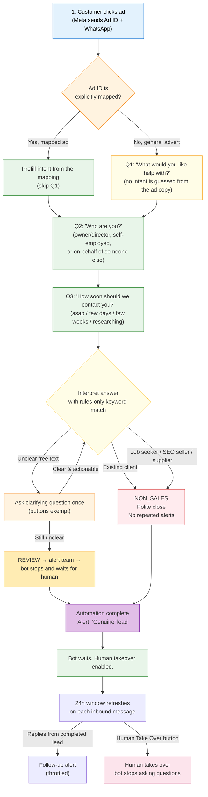

# HD Lead System (WhatsApp) — Simple Guide

> This document is the operating guide for HD Accountancy and 3N Soft/Mento after the Meta / WhatsApp Lead Qualification Technical Review (9 November 2026). All P0 review items, all P1 review items, and the new retention / purge / alert-visibility behaviour are implemented in `hd_backend` as of this release.

---

## What is this?

When someone clicks your Facebook/Instagram ad and taps **"Send WhatsApp message"**, WhatsApp opens with HD Accountancy. Instead of you replying manually, a small assistant asks 2–3 short questions, then alerts you about the new lead. You can then open the chat in your admin panel and take over the conversation yourself.

**How the assistant works:** it uses WhatsApp buttons and lists plus fixed
rule-based interpretation (keyword matching). **No external AI service is used.**
That keeps it predictable and cheap; the trade-off is that unusual free-text
replies may be sent to **REVIEW** for a human decision instead of being guessed.

## How the system flows



## How it works, step by step

1. **Customer clicks the ad** → Meta sends the Ad ID as part of the referral payload and opens WhatsApp with HD Accountancy. The Ad ID itself is sent to our webhook; the advert's headline/body/copy is **never** used to infer intent.
2. **Campaign routing is explicit.** Each advert is mapped to a qualification route by **Ad ID** in the admin panel (`Campaign mapping` on the leads page).
   - Known/mapped advert → the first question is skipped, the route is prefilled.
   - Unmapped/general advert → the bot asks question 1.
   - The advert's visible text is **never** used to guess intent — only the admin mapping table matters.
   - **A mapped route is authoritative.** If the pre-filled WhatsApp text mentions another service ("I need help with payroll" on a Change-Accountant advert), the route stays whatever the mapping says and the extra service is stored as context (`mentioned_intent`).
   - **First-touch attribution is never rewritten.** If the same person later clicks a different advert, the original ad/campaign/click ID is kept for reporting and the extra click is recorded separately (`latest_touch_*`).
   - **Recruitment, supplier or vacancy wording alone never rejects a lead.** Only clear job-seeker/seller enquiries with no accounting need are closed as Non-sales; anything mentioning accountancy work continues to qualify or goes to Review.

   Exact field-by-field behaviour lives in `hd_backend/app/Services/LeadInterpreter.php` (routing rules) and `WhatsAppWebhookController` (attribution).
3. **Assistant asks the short questions it still needs:**
   - What do you need help with? (only asked if the advert is unmapped)
   - Who are you? (owner/director, self-employed, or for someone else)
   - How soon should we contact you? (as soon as possible, in a few days/weeks, just researching)
4. **Assistant alerts you** with the person's name, number, what they need and how urgent it is, then marks the lead Genuine / Review / Non-sales.
   A job seeker, SEO seller or supplier is closed politely — unless they also mention accounting, payroll, VAT, bookkeeping or tax work, in which case they keep qualifying. An existing HD client is separated from new sales leads. Unclear free text gets one clarifying question, then goes to **Review**. A voice note, photo, document, sticker, location or shared contact cannot be answered with buttons, so it goes straight to **Review** with an alert and a note on the lead.
5. **You open the chat in the admin panel** (`/admin/leads`), read what they said and reply yourself. Once you take over, the assistant stops asking questions and you chat normally — even if a turn was already running when you took over. A staff message that fails to send does **not** switch the assistant off. Replies from a finished lead are stored and alerted, but never restart the bot, and marking a lead finished by hand stops the bot for good.

## Why the assistant uses rules, not AI

- Route intents via explicit admin-mapped Ad ID, never ad copy.
- Keyword-match free text against ~20 common enquiry phrases for intent, person type, and timeframe.
- Anything recognised → answer used directly. Anything unknown → one clarifying question, second attempt → REVIEW.
- No LLM, no external API call. Deterministic, cheap, auditable.

## What we need from you (Meta / Facebook side)

### Things only you can do

- [ ] **A Facebook/Instagram ad** with the "Send WhatsApp message" button pointing to the HD Accountancy WhatsApp number
- [ ] **A dedicated phone number** for the WhatsApp Business account. It must be able to receive the Meta/WhatsApp verification code **by SMS or voice call** and meet the WhatsApp Business Platform number requirements. It does not have to be a mobile handset — but it must not be a number you cannot verify.
- [ ] **Meta Business Portfolio / Partner asset access** — HD grants 3N Soft/Mento access to the following assets from **Business Settings → Partners → Add → Give partner access**. HD remains the owner at all times:
  1. The HD Ad Account
  2. The Facebook Page
  3. The Instagram account (if used)
  4. The WhatsApp Business Account
  5. The Pixel / Dataset (if used)
  6. The Meta developer app area (free — we set this up with you)

> **Never share your Facebook/Meta username or password.** We do not need it and must never be given it. Partner asset access is the correct, revocable method.

## Admin tools

| Page | What it does |
|---|---|
| `/admin/leads` | All leads, filters, status counts |
| `/admin/leads/ad-intents` | Map each Ad ID (and optionally Campaign ID) to a qualification route. Unknown/unmapped adverts ask the first question. |
| `/admin/leads/health` | Configuration readiness + test email / SMS / WhatsApp |
| `/admin/leads/{id}` | Conversation, takeover, reply, notes, sales lifecycle, alert state |

**Adding an advert:** open **Campaign mapping**, paste the Ad ID from Ads Manager and choose the route (`change_accountant`, `landlord_property`, `hmrc_issue`, `tax_vat_payroll`, `need_accountant`, `other`). An advert you do not map simply asks the first question — that is safe, not broken.

**If an alert fails**, the lead still appears in the list, and the alert row on the lead page shows `failed` with the reason. Use **Resend alert** on the lead, or **Test email / Test SMS / Test WhatsApp** on the Health page to diagnose.

**Archive & clear lead database:** a maintenance action, super-admin only. Requires typing `DELETE`. It is *not* a full purge — a complete JSON archive is written to `storage/app/lead-archives` **before** anything is deleted, so the personal data still exists on disk until the archive retention policy removes it (`LEAD_ARCHIVE_RETENTION_DAYS`, default 365 days, applied by the scheduled `leads:prune`). Routine retention (rejected/non-sales leads older than `LEAD_RETENTION_DAYS`, default 365, and raw payload older than `LEAD_RAW_PAYLOAD_RETENTION_DAYS`, default 90) is handled by the same scheduled command daily at 02:30 and does not touch genuine / won leads. To grant maintenance permission:

```bash
php artisan tinker --execute="App\Models\User::where('email','you@example.com')->update(['super_admin'=>1]);"
```

## Alert delivery (no more silent failures)

Every notification attempt is recorded on the lead row, never ignored silently:

- `alert_status`: `sent`, `partial`, `failed`, or `not_configured`
- `alert_last_error`: short error text
- `alert_last_attempt_at`: timestamp of last delivery attempt

Health page “Test email / Test SMS / Test WhatsApp” buttons let anyone confirm the email, Twilio and WhatsApp paths. On the lead page you see a badge (green=ok, red=failed) plus the error text, and a **Resend alert** button restarts delivery.

> Note: retries are manual (Resend) rather than auto-queued retries, so the bot does not spend CPU re-sending indefinitely. PDF allowed *either* status tracking *or* queued retry; we chose observable status tracking.

## Retention and data minimisation

- Scheduled `leads:prune` runs daily at **02:30**:
  - **REJECTED / NON_SALES lead older than `LEAD_RETENTION_DAYS` (default 365) → the lead row is deleted, and `lead_messages.lead_id` is `ON DELETE CASCADE`, so all of that lead's messages are deleted with it.** Nothing of that lead remains in the database. This is intended: a rejected non-sales enquiry should not be kept indefinitely.
  - Strips the raw full Meta payload (`raw_payload = null`) from messages older than `LEAD_RAW_PAYLOAD_RETENTION_DAYS` (default 90). This applies to **retained** leads only, and keeps the qualification data and the readable conversation text.
  - Deletes archive files older than `LEAD_ARCHIVE_RETENTION_DAYS` (default 365). Set it to `0` to keep archives until they are reviewed and deleted by hand.
- **Archive & clear lead database** (super-admin only): writes a JSON archive to `storage/app/lead-archives/leads-YYYYMMDD-HHMMSS.json`, then deletes all leads and messages in one transaction. Because that archive is itself personal data, it is subject to the archive retention policy above — it is not an unlimited backup.

## One simple check (not a go-live test)

Open the **Health page** (`/admin/leads/health`). Green items mean the configuration is present; “Optional” items are genuinely optional and are never shown as a failure.

> Green does **not** mean the system is live and working. It only means the credentials and settings are in place. Complete the real end-to-end test below before go-live.

## What happens after

- New leads arrive as **email alerts** — no need to keep checking anything.
- You view and reply to all chats from **one admin page** on your computer.
- If a lead is not a real customer (e.g. job seekers, spam), the assistant politely closes it and does not bother you.

## Who owns what (agreed operating model)

| Responsibility | Owner |
|---|---|
| Receiving lead alerts | HD sales inbox / alert phone (confirm the address and number) |
| Monitoring **REVIEW** leads | HD sales lead — reviewed daily |
| Closing **WON / LOST / CLOSED** records | HD sales lead — kept current so old chats do not stay open |
| Meta assets, adverts, WhatsApp number, mapping | HD (grants partner access to 3N Soft/Mento) |
| Queue worker, scheduler, credentials, templates | 3N Soft / Mento |
| Existing agency | Stays active until the end-to-end acceptance test passes |

## Packaging

The configuration points at this guide with a relative path (`../LEAD_SYSTEM.md` from `hd_backend/.env.example`).
When the deployment ZIP is built, include both so the path resolves:

```
hd_backend/          <- the Laravel application
LEAD_SYSTEM.md       <- this operating + deployment guide, at the parent level
```

## Go-live checklist

- [ ] All P0 and P1 review items completed and reviewed
- [ ] HD grants Meta Business Portfolio / Partner asset access — no credential sharing
- [ ] Dedicated WhatsApp Business Platform number verified and connected
- [ ] Meta app webhook URL configured and verified
- [ ] `META_APP_SECRET`, verify token, WhatsApp access token and phone number ID set in production
- [ ] Dedicated **Marketing API** token in `META_ADS_ACCESS_TOKEN` if campaign/ad name enrichment is wanted
  (do not rely on the WhatsApp token having Marketing API permissions; prefer a system-user token, not a short-lived personal one)
- [ ] `META_GRAPH_VERSION` reviewed and pinned deliberately for this deployment (do not leave an old default indefinitely)
- [ ] Queue worker supervised and continuously running on `leads,default`
- [ ] Laravel scheduler installed — `leads:prune` runs daily at 02:30
- [ ] Production SMTP tested from the Health page or a real test notification
- [ ] At least one approved re-engagement template configured if post-24-hour outreach is wanted
- [ ] Current HD ad/campaign IDs mapped to the intended qualification route
- [ ] Data retention agreed and documented: lead retention, raw payload retention, **and archive retention** (`LEAD_ARCHIVE_RETENTION_DAYS`) — an archive still contains personal data
- [ ] Full end-to-end test performed from a **real Meta ad preview/test ad** through WhatsApp to `/admin/leads`
- [ ] Shultan/HD verifies the Genuine/Review/Non-sales classifications from test leads

## Final acceptance test

Do **not** call the system "live" because the Health page is green.

1. Open a real/test HD Meta advert.
2. Tap **Send WhatsApp Message**.
3. Send the initial message from a real WhatsApp account.
4. Confirm the lead appears in `/admin/leads` with correct Ad/Campaign attribution.
5. Complete the 2–3 qualification questions.
6. Confirm the Genuine/Review/Non-sales result is correct.
7. Confirm HD receives the lead alert.
8. Shultan/Sakib clicks **Take Over** and sends a WhatsApp reply.
9. Confirm the prospect receives the human reply and the bot remains stopped.
10. Close the lead and verify the sales lifecycle/audit remains intact.

---

**In short:** your job is the ad + the WhatsApp number + the Ad ID mapping.
Our job is the assistant, the alerts and the admin panel.
